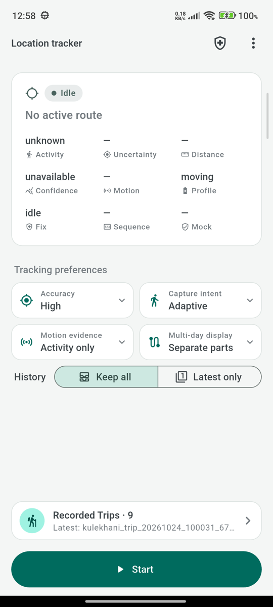
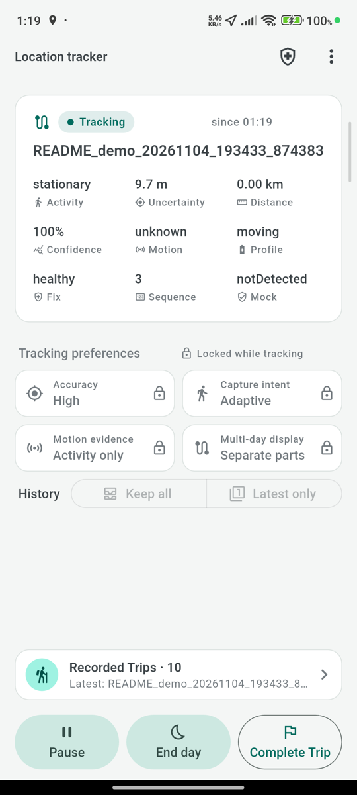
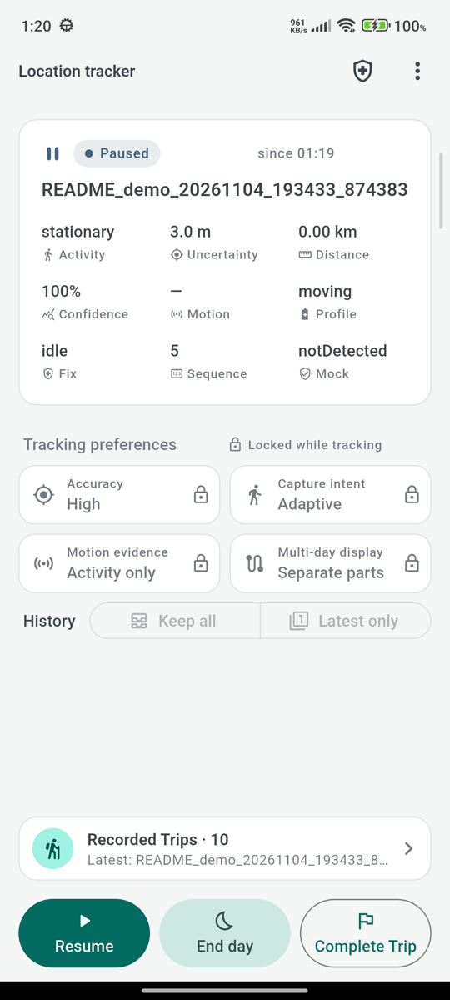
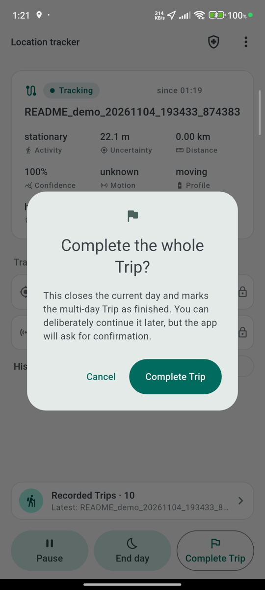
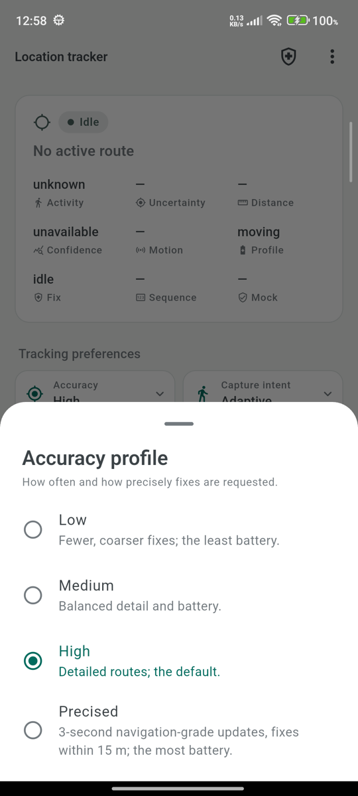
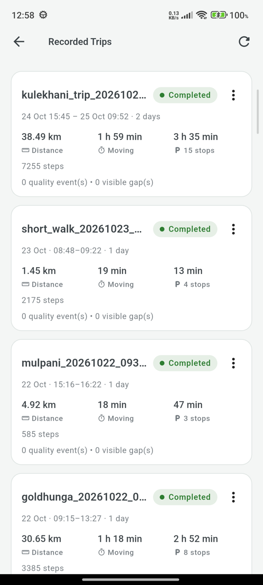
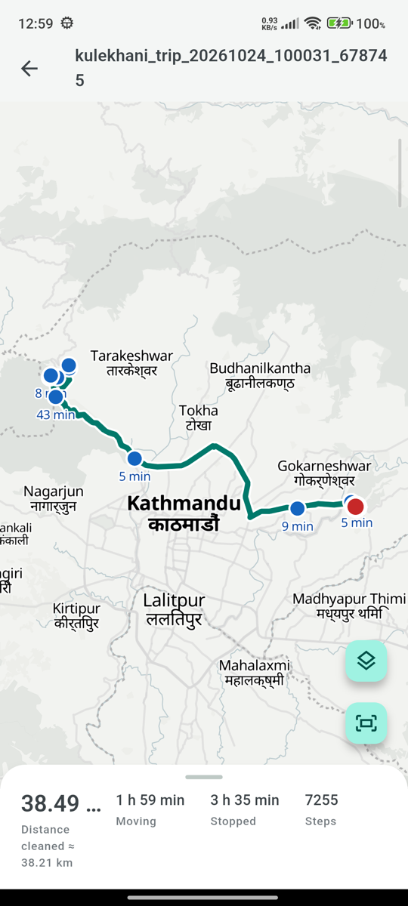
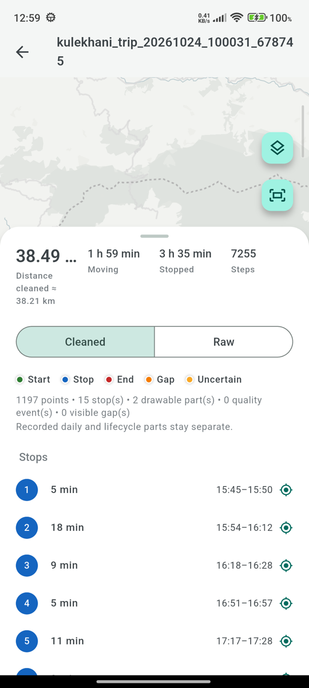

# flutter_background_location_tracker

Durable, battery-aware route tracking for Android and iOS. Record a route from
**Start** to **Complete** in the foreground and background, keep it in SQLite,
and get its stops, steps, distance and moving time without computing anything,
then export it as GeoJSON, KML or GPX.

> Background location is privacy-sensitive and controlled by the operating
> system. Callback intervals and process lifetime are never guaranteed. Test
> your exact configuration on real devices before releasing it.

<table>
  <tr>
    <td align="center"></td>
    <td align="center"></td>
    <td align="center"></td>
    <td align="center"></td>
  </tr>
  <tr>
    <td align="center">Ready to start</td>
    <td align="center">Recording</td>
    <td align="center">Paused</td>
    <td align="center">Complete Trip</td>
  </tr>
  <tr>
    <td align="center"></td>
    <td align="center"></td>
    <td align="center"></td>
    <td align="center"></td>
  </tr>
  <tr>
    <td align="center">Tracking preferences</td>
    <td align="center">Recorded Trips</td>
    <td align="center">Route map</td>
    <td align="center">Stops and figures</td>
  </tr>
</table>

<sub>Screenshots from the bundled example app on Android (debug build; debug
builds add diagnostic views such as gap markers and route views).</sub>

## Features

- **Capture:** foreground and background recording with Pause, Resume and
  Complete, an Android foreground service, and a native journal that keeps
  every fix until the route database has stored it.
- **Clean routes:** adaptive sampling that saves battery while still, stop
  detection that keeps indoor jitter out of the route and its distance, turn
  capture at junctions, and the same decisions on every phone.
- **Route details stored for you:** distance, moving, stopped and paused time,
  stops with their place and times, steps, speeds, quality events and gaps.
- **Multi-day Trips:** End day and Continue trip, shown and exported as one
  journey.
- **Export:** GeoJSON, KML and GPX with stops and summaries, offline
  conversion between the three formats, and an optional cleaned view.
- **Evidence, not guesses:** activity classification, mock-location evidence
  per fix, and typed gaps. Nothing is interpolated into the recorded points.
- **Release-ready:** release builds keep a clean, lightweight route; debug
  builds keep everything for field testing.
- **Lightweight:** no HTTP client, map SDK or state-management dependency. An
  optional, host-supplied uploader gets durable, ordered, at-least-once
  batches.

## Platform support

| Platform | Minimum | Native implementation |
|---|---:|---|
| Flutter | 3.22 (Dart 3.4) | |
| Android | API 21 | Fused Location Provider, Activity Recognition, foreground service |
| iOS | 13.0 | Core Location and Core Motion |

The Android plugin targets Java 17 and compile SDK 35. iOS supports
CocoaPods and Swift Package Manager.

## Installation

```yaml
dependencies:
  flutter_background_location_tracker: ^1.0.0
```

```dart
import 'package:flutter_background_location_tracker/flutter_background_location_tracker.dart';
```

## Platform setup

### Android

The plugin's manifest is merged into your app automatically. It declares fine,
coarse and background location, the `location` foreground service,
notifications, activity recognition, boot completion and `WAKE_LOCK` (held only
while capture is active). Don't duplicate or remove them.

Start or resume capture only when all of these are true:

- Location Services are on and **Precise** location is granted.
- Background location is **Allow all the time**. On Android 11 and later the
  user can only choose it in Settings.
- Notifications are allowed (Android 13 and later).
- The command comes from a visible screen after a user action.

Activity Recognition is optional. Without it, the route still records, but
activity is unknown, battery-saving stays conservative, and steps are not
counted.

### iOS

Enable **Runner → Signing & Capabilities → Background Modes → Location
updates**, and add these keys to `Info.plist` with product-specific text:

```xml
<key>NSLocationWhenInUseUsageDescription</key>
<string>Location is used to record your route while a trip is active.</string>
<key>NSLocationAlwaysAndWhenInUseUsageDescription</key>
<string>Your active trip continues to record when the app is in the background.</string>
<key>NSMotionUsageDescription</key>
<string>Motion helps adjust location frequency and reduce battery use.</string>
<key>UIBackgroundModes</key>
<array>
    <string>location</string>
</array>
```

Tracking needs **Always** and **Precise Location**. The user grants When In
Use first, then **Change to Always Allow**. Without Motion & Fitness access
the route stays on the moving profile and steps are not counted.

Neither platform lets an app grant background access itself. Drive the flow
with `checkReadiness()` and `requestNextPermission()`, one step per user tap.
The full manifest, the permission sequence per Android version, Play and App
Store notes, and iOS termination recovery are in
[Platform setup](https://github.com/amias-samir/flutter_background_location/blob/main/doc/platform_setup.md).

## Quick start

Open **one** application-scoped controller for the signed-in owner. Render
every lifecycle button from `sessionStream`, never from local widget flags.

```dart
const owner = TrackingOwner(
  userId: 'signed-in-user',
  organizationId: 'workspace-id',
);

final tracking = await TrackingClient.openWithTrips(
  owner: owner,
  configuration: const TrackingConfiguration(
    defaultTrackingConfig: TrackingConfig(
      accuracy: TrackingAccuracy.high,
      captureIntent: RouteCaptureIntent.adaptive,
    ),
  ),
);

tracking.sessionStream.listen((session) {
  final actions = session.allowedActions;
  // Show Start / Pause / Resume / Complete from
  // actions.canStartNew, canPause, canResume, canComplete.
});

// From the Start button:
Future<String?> start() async {
  final readiness = await tracking.checkReadiness();
  if (!readiness.canStart) {
    // Explain readiness.nextAction, then on the user's next tap:
    await tracking.requestNextPermission(); // or openSettings(...)
    return null;
  }
  final result = await tracking.startTrip(
    const TripStartRequest(routeId: 'Field visit'),
  );
  return result.trip.id;
}

// Pause and resume within a day:
await tracking.pauseCurrentTrack();
await tracking.resumeCurrentTrack();

// End the day (stops capture), continue tomorrow, or finish the journey:
await tracking.endCurrentDay();
await tracking.continueTrip(tripId);
await tracking.completeTrip(tripId);

// At sign-out, after Pause or Complete:
await tracking.dispose();
```

Use `TrackingClient.open()` instead when routes are single-day only. It gives
the same Track controls without Trips: `startNewTrack`, `pauseTrack`,
`resumeTrack` and `completeTrack`.

| API | Use |
|---|---|
| `TrackingClient.open()` / `openWithTrips()` | Initialize and restore one owner-scoped controller |
| `TrackingSessionSnapshot.allowedActions` | Which lifecycle buttons to enable |
| `checkReadiness()` / `requestNextPermission()` / `openSettings()` | Staged, user-driven permission setup |
| `TrackingConfig` | Accuracy preset, capture intent, sampling and stop settings |
| `listTrackPage()` / `listTripPage()` | Paged, owner-scoped route history |
| `loadTrackBundle()` / `loadTripBundle()` | Points, segments, stops, gaps and summary of one route |
| `assembleTripRouteGeometry()` | Map-ready parts, the same topology the exports use |
| `exportTrack()` / `exportTrip()` | GeoJSON, KML and GPX files |
| `deleteTrack()` / `deleteTrip()` | Remove completed routes |

Pass a stable `operationId` to lifecycle commands you may retry; the package
makes them idempotent and recovers them after a restart. Step-by-step
guidance: [Integration guide](https://github.com/amias-samir/flutter_background_location/blob/main/doc/integration_guide.md) ·
[Multi-day Trips](https://github.com/amias-samir/flutter_background_location/blob/main/doc/multi_day_trips.md).

## Route details

Each route's figures are kept up to date in the database as it records, so a
host shows them directly:

```dart
final summary =
    await (tracking as TrackingSummaryController).routeSummary(trackId);
print('${summary.displayDistanceMeters} m · moving ${summary.moving} · '
    '${summary.stopCount} stops (${summary.stopped}) · '
    '${summary.stepCount ?? '–'} steps');
```

| Value | Meaning |
|---|---|
| `displayDistanceMeters` | The distance to show (corrected for routes recorded under older rules) |
| `moving`, `stopped`, `paused`, `elapsed` | Time split; pauses are excluded from `recording` |
| `stopCount` | Stops: stays of at least `minimumStopDuration` (5 minutes by default) at one place |
| `stepCount`, `stepCountStoppedAt` | Steps counted on the route; never estimated, and marked when the counter stopped |
| `maxSpeedMetersPerSecond`, `averageMovingSpeedMetersPerSecond` | Doppler maximum and moving average |
| `qualityEventCount`, `visibleGapCount` | Holes in the route worth a look (full-detail routes) |

- **Stops** are stored with their place, radius and times (`TrackStop`), shown
  in `TrackBundle.stops` and exported by default. Fixes that wander at a stop
  are kept as rejected evidence, so they add no distance and draw no scribble.
- **Steps** come from the phone's step counter (Android) or pedometer (iOS) on
  every route, using the activity permission the package already requests. It
  never prompts for them. Steps are fitness data: they stay out of upload
  batches' `toMap()`.
- **Distance** counts only measured edges. Connectors drawn across a pause or
  overnight are labeled inferred and never count.

How stops, quality decisions, turn capture, steps and reviewed routes work:
[Route details](https://github.com/amias-samir/flutter_background_location/blob/main/doc/route_details.md).

## Export

```dart
final result = await tracking.exportTrip(
  tripId: tripId,
  format: TrackExportFormat.gpx, // or geoJson, kml
  fileName: 'field visit', // optional; defaults to the route identifier
);
```

- Completed routes export by default; a snapshot of an active route needs
  `TrackExportOptions(allowIncompleteTrackSnapshot: true)`.
- Files go to `Download/flutter_background_location` on Android (MediaStore,
  no storage permission on Android 10+) and to the app's
  `Documents/flutter_background_location` on iOS. Name collisions get `_1`,
  `_2` suffixes.
- Exports keep segment boundaries, leave rejected points out, and include stops
  and the route summary. KML heights are written as recorded (0 when unknown,
  no `altitudeMode`); Android heights are above the WGS 84 ellipsoid and iOS
  heights above mean sea level.
- `RouteFormatConverter` converts GeoJSON, GPX and KML in memory, in all six
  directions.

Export files are plaintext; delete them after sharing (`deleteExport()` removes
a Track export).
The bounded V2 exporter, derived (cleaned) geometry, abort, delete and erase
are covered in [Export](https://github.com/amias-samir/flutter_background_location/blob/main/doc/export.md).

## Configuration

Pick an accuracy preset; any individual `TrackingConfig` value you set
overrides only its own preset value.

| Preset | Moving interval / filter | Stationary interval / filter | Accepted accuracy |
|---|---:|---:|---:|
| `low` | 20 s / 20 m | 2 min / 75 m | 100 m |
| `medium` | 10 s / 10 m | 1 min / 50 m | 60 m |
| `high` (default) | 5 s / 5 m | 20 s / 20 m | 20 m |
| `precised` | 3 s / 3 m | 15 s / 10 m | 15 m |

- `captureIntent`: `adaptive` (default) saves battery while still and records
  stops; `walking`, `cycling` and `vehicle` stay on the moving profile.
- `motionFusionMode`: `platformActivityOnly` (default), or low-power or
  enhanced sensor fusion for better pocket and background motion evidence.
- `minimumStopDuration`, `turnCaptureDegrees` (45° for High and Precised) and
  `mockLocationPolicy` (`allow`, `flag` or `reject`).
- `TrackingConfiguration.recordRetentionPolicy`: `keepAll` (default) or
  `keepLatestOnly`.

**Release builds record a clean route.** By default
(`RouteRecordingDetail.automatic`) profile and release builds store the
accepted path, stops, distance and steps without diagnostic quality runs,
visible gaps or motion evidence; debug builds keep everything. Capture,
distance, stops, steps and uploads are identical in both. Each route keeps the
mode it started with. Set `recordingDetail` to force one.

Operating systems may batch, delay or skip callbacks, and `high` and
`precised` use more battery. Every option, adaptive battery policies and
mock-location interpretation:
[Configuration](https://github.com/amias-samir/flutter_background_location/blob/main/doc/configuration.md).

## Lifecycle limits

| Scenario | Android | iOS |
|---|---|---|
| Background or screen lock while active | Continues in the foreground service with an active-capture partial wake lock | Continues with Core Location background mode (iOS 17+ background-activity session) |
| Paused, completed | Service, notification and requests stop | Location, motion and background sessions stop |
| Removed from recent apps | Usually continues; OEM-dependent | Swiping away is a user force-quit and stops tracking |
| OS process termination | Best-effort service recovery | Route is kept as interrupted and resumed explicitly after launch |
| Android Force stop | Cannot be bypassed | Not applicable |
| Reboot | Best-effort restoration; OEM-dependent | The app must be launched again |

A route is never silently marked complete after an interruption.

## Storage, security, and privacy

- SQLite is the source of truth. Native fixes are removed from the journal only
  after Dart has committed them.
- The default database is not encrypted. Inject your own `TrackRepository` if
  your threat model needs encryption.
- Diagnostics and support reports never contain coordinates, route or owner
  IDs, file names or command tokens.
- `notDetected` mock evidence is a signal, not proof that a fix is genuine.

Your app is responsible for:

- a clear in-app tracking indicator and a way to pause and complete;
- explaining background, motion and step access;
- its Play Console declaration, Data safety and App Store privacy answers,
  including fitness data if you upload steps;
- a retention policy, and deleting plaintext exports.

## Production checklist

- Use product-specific permission and notification text.
- Test on physical Android and iOS devices; simulators are insufficient.
- Measure multi-hour route fidelity and battery drain together.
- Test denied, revoked and reduced-accuracy permissions, disabled location
  services, and OEM battery restrictions.
- Test backgrounding, screen lock, recent-task removal, process death,
  force-stop or force-quit, and reboot separately.
- Test offline capture and later upload recovery.
- Validate exports in an independent GeoJSON or XML reader.

## Example app

The [example](https://github.com/amias-samir/flutter_background_location/tree/main/example)
is a complete Material app built on `openWithTrips()`:

- A single home screen shows the current session and the tracking preferences
  (pickers). Its bottom bar offers only the actions the lifecycle allows now:
  Start, Pause, Resume, End day and Complete Trip.
- Staged permission recovery, a setup doctor and owner-conflict recovery.
- A History screen with a card per Trip (distance, moving and stopped time,
  steps). Tap a card for its map; GeoJSON, KML and GPX export are in the card
  menu.
- A full-screen MapLibre map with a draggable sheet: figures, legend and the
  stop list (tap a stop to fly to it), plus a fit-route button. Debug builds
  add gap markers, route views and a continuity toggle.

```shell
cd example && flutter run
```

## Guides

| Guide | Covers |
|---|---|
| [Platform setup](https://github.com/amias-samir/flutter_background_location/blob/main/doc/platform_setup.md) | Manifest, `Info.plist`, permission sequences, background and termination behavior |
| [Integration guide](https://github.com/amias-samir/flutter_background_location/blob/main/doc/integration_guide.md) | Single-day controller, permissions, diagnostics, owner conflicts, uploads, tests, troubleshooting |
| [Multi-day Trips](https://github.com/amias-samir/flutter_background_location/blob/main/doc/multi_day_trips.md) | End day, Continue trip, restore after restart, presentation, Trip export and deletion |
| [Route details](https://github.com/amias-samir/flutter_background_location/blob/main/doc/route_details.md) | Stops, quality decisions, turn capture, summaries, steps, derived geometry, clean recording |
| [Export](https://github.com/amias-samir/flutter_background_location/blob/main/doc/export.md) | Export options and formats, V2 exporter, format conversion, abort/delete/erase |
| [Configuration](https://github.com/amias-samir/flutter_background_location/blob/main/doc/configuration.md) | Every `TrackingConfig` option, retention, battery behavior, mock locations |

---

## 🥟 Support this project

> **Did this plugin save you development time or help your application?**
> Your support helps fund maintenance, platform updates, testing on real
> devices, and new features for the Flutter community.

<p align="center">
  <a href="https://buymemomo.com/firantey">
    
  </a>
</p>

<p align="center">
  <strong>💛 One plate of MOMO helps keep this plugin maintained and improving.</strong>
</p>

**Support link:** [buymemomo.com/firantey](https://buymemomo.com/firantey)

## License

See the
[MIT license](https://github.com/amias-samir/flutter_background_location/blob/main/LICENSE).
